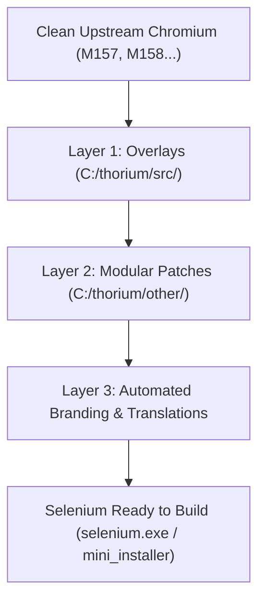
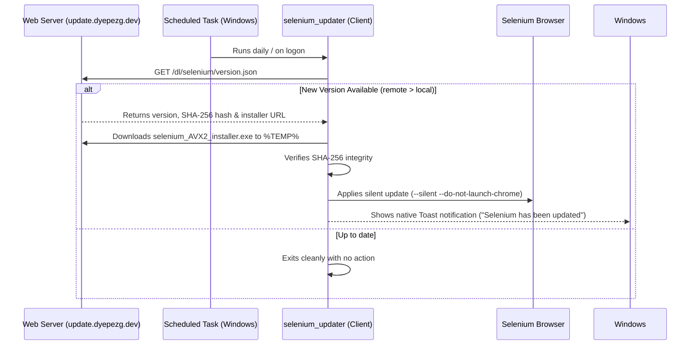

# Master Development, Maintenance & Migration Guide: Selenium Browser

This guide documents the architecture, workflow, and standard operating procedures for maintaining and updating the **Selenium** browser (based on Chromium / Thorium), ensuring **zero customizations are lost** when migrating between major milestones (e.g. from **M157 to M158**).

---

## 1. Core Principle: The Single Source of Truth

In Chromium-based browser development, there are two distinct directory trees with different purposes:

| Directory | Purpose | Golden Rule |
| :--- | :--- | :--- |
| **`C:\thorium`** | **Single Source of Truth** | All Selenium code, patches, logos, scripts, and configurations live and are committed here on dedicated branches (`selenium-157`, `selenium-158`). |
| **`C:\src\chromium\src`** | **Build Workspace** | An ephemeral workspace managed by `gclient`. Switching branches or updating in this directory **wipes or overwrites** any manual changes not backed up in `C:\thorium`. |

> [!CAUTION]
> **Never rely on changes made directly in `C:\src\chromium\src` without syncing them to `C:\thorium`.** Always sync before switching versions.

---

## 2. Selenium 3-Layer Architecture

To prevent patches from breaking whenever Google modifies upstream Chromium code, Selenium organizes its customizations into 3 decoupled layers:



### Layer 1: Overlays (`C:\thorium\src\`)
Full files replacing upstream counterparts or providing new Selenium-specific components.
* **Key Selenium Files**:
  * `chrome/browser/ui/tabs/features.cc`: Enables `kTabStripUnification` by default for horizontal tab scrolling and `<` / `>` buttons.
  * `chrome/browser/ui/views/frame/horizontal_tab_strip_region_view.cc`: Tab strip manager with smooth scroll and controls.
  * `chrome/browser/ui/views/frame/browser_root_view.cc`: Smooth mouse wheel tab scrolling (`OnMouseWheel`).
  * `chrome/browser/ui/tabs/tab_style.cc`: Legible minimum tab width (120 DIP).
  * `chrome/browser/ui/omnibox/omnibox_view.cc`: Prevents badge overflow on internal pages by constraining icons to 16x16 DIP.
  * `chrome/app/theme/chromium/win/chromium.ico`: Multi-resolution official icon (16x16 up to 256x256).

### Layer 2: Modular Patches (`C:\thorium\other\*.patch`)
Surgical changes to native Chromium files applied via `setup.py` according to `patch_scripts/series/series`.
* Kept **small and independent** (single concern per patch).
* If a future Google update changes a method signature, only that specific patch is isolated without breaking the rest of the build.

### Layer 3: Automated Branding & Internationalization (i18n)
* **`apply_selenium_logos.py`**: Injects Selenium logos across all resolutions (16, 24, 32, 48, 64, 128, 256, 512, 1024, SVG, and ICO) into the Chromium theme paths.
* **`apply_selenium_branding.py`**:
  * Modifies `BRANDING` to define product and installer names.
  * Updates install paths to `%LOCALAPPDATA%\Selenium\Application`.
  * Replaces branding strings across `.grd` definition files and `.xtb` translation catalogs.

---

## 3. Translation Engine (i18n) & GRIT

### Why did some strings appear in English (e.g. "About Selenium")?
In Chromium, translations do not use variable names like `IDS_ABOUT`, but **64-bit numerical fingerprints (Message IDs)** generated from the English source string:
$$\text{MessageId} = \text{FingerPrint}(\text{English text})$$

* Original text `About &Chromium`: ID `2910007522516064972`.
* Thorium modification `About &Thorium`: ID `3892055234200984404`.
* Selenium rebranding `About &Selenium`: ID `5317043475803852094`.

If an `.xtb` file (such as `chromium_strings_es-419.xtb` for Spanish) retains the old ID, GRIT cannot find a translation match for the new fingerprint and **falls back to the English source string**. The branding pipeline updates both strings and their corresponding fingerprint IDs.

---

## 4. Runbook: Upgrading Versions (e.g. M157 ➔ M158)

Follow this structured step-by-step procedure to upgrade without losing customizations:

### Phase A: Freeze & Backup Current Version
1. Open a terminal in `C:\thorium`.
2. Sync modified workspace files:
   ```cmd
   cd C:\thorium
   python sync_src_to_thorium.py
   ```
3. Commit and tag the stable version:
   ```cmd
   git add -A
   git commit -m "Selenium M157 final stable"
   git tag -f selenium-157-stable
   ```

### Phase B: Create New Branch in Thorium
Create a clean branch for the new milestone:
```cmd
cd C:\thorium
git checkout -b selenium-158
```

### Phase C: Fetch & Checkout Upstream Chromium
1. Navigate to the Chromium source directory:
   ```cmd
   cd C:\src\chromium\src
   ```
2. Fetch upstream tags:
   ```cmd
   git fetch --tags
   ```
3. Switch to the target tag (e.g. `158.0.8120.1`):
   ```cmd
   git checkout tags/158.0.8120.1
   gclient sync -D --force --reset
   ```

### Phase D: Apply Selenium Overlays & Patches
1. Return to `C:\thorium` and apply patches and overlays:
   ```cmd
   cd C:\thorium
   python setup.py --avx2
   ```
2. Inject logos and visual assets:
   ```cmd
   python apply_selenium_logos.py
   ```
3. Inject branding strings, paths, and updater definitions:
   ```cmd
   python apply_selenium_branding.py
   ```

### Phase E: Verification & Compilation
1. Run a dry run to validate the dependency graph:
   ```cmd
   cd C:\src\chromium\src
   autoninja -C out\thorium -n chrome
   ```
2. Build the browser and installer:
   ```cmd
   autoninja -C out\thorium -local_jobs 8 -k 0 chrome mini_installer
   ```

---

## 5. Troubleshooting Common Issues

### 1. `Permission Denied` Linking `chrome_elf.dll` or `selenium.exe`
* **Cause**: A running Selenium process is locking the binary files.
* **Fix**: Terminate running instances before building:
  ```cmd
  taskkill /F /IM selenium.exe >nul 2>&1
  ```

### 2. Taskbar Icon Shows Generic White Page
* **Cause**: Windows relies on `AppUserModelID` (`Selenium`). Running directly from `out\thorium\` without installing leaves the shortcut unregistered in the Start Menu.
* **Fix**:
  1. Unpin the broken taskbar icon.
  2. Run `powershell -ExecutionPolicy Bypass -File C:\thorium\create_shortcuts.ps1`.
  3. Launch Selenium from the shortcut and re-pin it.

### 3. Tabs Do Not Scroll or Missing Scroll Buttons
* **Cause**: `kTabStripUnification` disabled in upstream Chromium.
* **Fix**: Ensure `src/chrome/browser/ui/tabs/features.cc` has:
  ```cpp
  BASE_FEATURE(kTabStripUnification, base::FEATURE_ENABLED_BY_DEFAULT);
  ```

### 4. Omnibox Favicon Appears Oversized on Internal Pages
* **Cause**: 32 DIP icon rendered in a 16 DIP container.
* **Fix**: In `chrome/browser/ui/omnibox/omnibox_view.cc`, use `GetSizedIcon` with `IDR_PRODUCT_LOGO_16`.

---

## 6. Background Auto-Update System

Selenium features a background update engine matching Google Chrome's update experience:



### Publishing a New Release
After compiling a new build:
1. Build the installer:
   ```cmd
   autoninja -C out\thorium -local_jobs 8 -k 0 mini_installer
   ```
2. Run the release packager:
   ```cmd
   cd C:\thorium
   python publish_release.py
   ```
3. Upload `server_release/version.json` and `server_release/selenium_AVX2_installer.exe` to `https://update.dyepezg.dev/dl/selenium/`.
